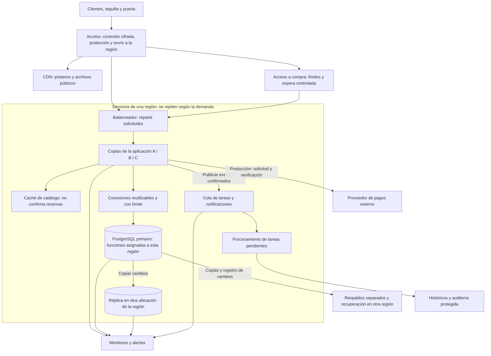

# Factibilidad técnica y operativa de BD IMAX

## 1. Dictamen

La infraestructura anterior no es adecuada para el servicio que pide la consigna. Si todo depende de una computadora y una conexión de internet, una falla puede detener las ventas y el ingreso a los cines. Además, una hoja compartida y un cobro manual no aseguran que cada asiento se venda una sola vez ni que los pagos queden correctamente registrados.

Proponemos repartir el trabajo entre varios servidores, utilizar PostgreSQL para controlar las operaciones y mantener copias que permitan recuperar el servicio. Cada decisión responde a un problema: atender más solicitudes, evitar ventas duplicadas o reducir el efecto de una falla. También implica costos y tareas de mantenimiento que deben evaluarse.

Esta es una propuesta de cómo construir el sistema. Para afirmar que soporta la demanda mundial todavía necesitamos aclarar las cifras, calcular los recursos y hacer pruebas. Nuestro prototipo permite comprobar las reglas que hemos implementado en una instalación local.

Este documento cubre A-05, [issue #5](https://github.com/Mauriart/BD_IMAX/issues/5). La comparación de proveedores, costos y ROI corresponde a A-06; el dimensionamiento detallado y las políticas globales de seguridad y continuidad se conciliarán con C. Puede avanzarse con este análisis sin que B/C hayan implementado sus módulos.

## 2. Datos de partida y límites de interpretación

La fuente principal es la consigna *Proyecto II - Diseño desde Cero de una BD.pdf*: escenario legado y escala en páginas 2-3, reglas en páginas 4-6, pago simulado en página 7 y fases DBLC en páginas 9-10. Los [acuerdos del equipo](00_acuerdos.md) complementan la organización. Las cifras del escenario académico no son mediciones del prototipo ni estadísticas verificadas de la empresa real.

| Dato de la consigna | Tratamiento en la propuesta |
| --- | --- |
| Más de 8 millones de usuarios concurrentes | Son personas usando la plataforma al mismo tiempo. El texto menciona tanto el primer minuto como la primera hora; se necesita aclarar esa diferencia. Cada persona puede hacer varias solicitudes y no necesita una conexión permanente con la BD. |
| Pico de 50.000 TPS durante 10 minutos | TPS significa transacciones por segundo. `50.000 × 600 = 30.000.000` en esa ventana. Antes de calcular servidores se debe aclarar qué cuenta como transacción: una compra completa, una reserva o una operación SQL. |
| 500 funciones diarias en 1.500 salas | Se utiliza literalmente «funciones», sin reemplazarlo por películas o títulos. No implica que todas las salas tengan funciones cada día. |
| 15 millones de boletos mensuales | Base para el volumen comercial; no equivale a 15 millones de compras ni a transacciones SQL, porque una compra admite varias entradas. |
| Auditoría durante al menos cinco años | Requisito del caso académico para eventos de transacciones, bloqueos y accesos. Se incluyen los intentos fallidos y las operaciones administrativas que correspondan. No se presenta como interpretación legal para todas las jurisdicciones. |

Para comprobar la coherencia comercial se adopta **solo como simplificación aritmética** un mes de 30 días:

- `500 × 30 = 15.000` funciones mensuales.
- `15.000.000 / 15.000 = 1.000` boletos vendidos por función, en promedio.
- Con ocupación inferior al 100 %, la capacidad media requerida sería todavía mayor: `capacidad media = 1.000 / proporción de ocupación`.
- `500 / 1.500 ≈ 0,33` funciones por sala al día, promediando todas las salas.

Estas cifras exigen aclarar capacidad, ocupación y distribución de funciones. No se corrige la consigna inventando otra cantidad de funciones o suponiendo capacidad suficiente. La factibilidad comercial de esos volúmenes queda condicionada a esa aclaración.

Saber cuántas personas están conectadas no indica por sí solo cuánto trabajo hacen. Algunas consultan la cartelera, otras reservan y otras pagan. Para calcular los recursos necesitamos conocer esas acciones, cuánto duran y cuántas personas intentan comprar los mismos asientos. El promedio del mes tampoco describe lo que ocurre durante un estreno.

## 3. Rechazo de las seis debilidades del legado

### 3.1 Base de datos y computadora

El escenario utiliza Access o un archivo SQLite en una computadora Core i3 de 2012. El problema es depender de un solo equipo para toda la operación mundial, sin pruebas de capacidad ni otro equipo preparado para atender una falla. SQLite sí permite transacciones, pero admite un solo escritor a la vez por archivo, lo que limita este escenario de muchas escrituras simultáneas.

Proponemos PostgreSQL en servidores destinados a esa tarea, con capacidad comprobada y una réplica en otra ubicación que no dependa del mismo equipo o alimentación. Elegimos mantener PostgreSQL porque ya lo usamos en el proyecto y permite controlar operaciones relacionadas mediante transacciones y restricciones.

Esto no resuelve todo por sí solo: habrá que medir cuántas operaciones soporta y qué ocurre cuando muchas personas compiten por los mismos asientos.

### 3.2 Conexión de red

La consigna concentra el tráfico en un enlace residencial de 50 Mbps, Wi-Fi y un extensor. Además del límite de velocidad, una falla de ese enlace dejaría sin comunicación a toda la operación.

Proponemos distribuir las solicitudes, entregar los archivos públicos desde servicios preparados para ello y usar conexiones alternativas en sedes críticas. La aplicación y la BD se comunicarían por una red privada.

Esta solución requiere presupuesto y pruebas: una conexión de respaldo solo ayuda si realmente puede entrar en servicio cuando se necesita. También seguirán existiendo retrasos por distancia y posibles fallas de proveedores.

### 3.3 Reservas en una hoja compartida

Escribir el nombre de un comprador en una hoja no asegura que otro usuario no haya elegido el mismo asiento al mismo tiempo. Tampoco relaciona de forma confiable la reserva, su vencimiento, el pago y el boleto.

Proponemos que la aplicación solicite la reserva y que PostgreSQL confirme el cambio mediante una transacción: un conjunto de operaciones que se guarda completo o se revierte si falla. Así se puede comprobar disponibilidad y registrar la reserva como una sola operación controlada.

La garantía depende de cómo se implemente. Debemos probar dos solicitudes sobre el mismo asiento y comprobar que solo una consiga reservarlo.

### 3.4 Datos de tarjetas y cobros manuales

Enviar tarjetas y CVV a un grupo de WhatsApp expone información financiera y dificulta asociar cada respuesta de pago con su compra. PCI SSC prohíbe conservar el código de verificación después de la autorización, incluso cifrado.

En el proyecto simulamos los pagos. Para un servicio real proponemos utilizar un proveedor de pagos evaluado y guardar la referencia y el resultado de cada operación, evitando recibir o registrar datos de tarjeta que no necesitamos.

El proveedor también puede fallar o responder tarde. Habrá que verificar sus respuestas, evitar cobros repetidos y revisar los pagos que queden pendientes. Contratarlo no demuestra por sí solo que toda la aplicación cumpla los requisitos de seguridad.

### 3.5 Recuperación después de una falla

Reiniciar la computadora puede solucionar algunos problemas, pero no recupera un disco dañado ni información borrada. El escenario tampoco indica quién atiende la falla ni cuánto tiempo se puede permanecer sin servicio.

Proponemos una copia operativa de la BD, respaldos separados y ejercicios de restauración. La copia operativa ayuda a continuar el servicio; los respaldos permiten volver a un estado anterior cuando se pierden o dañan datos.

También hay que comprobar que esas copias funcionen. Una réplica puede recibir un borrado accidental y un respaldo puede estar incompleto o ser inaccesible.

### 3.6 Cálculo de recursos

La consigna ofrece cifras de usuarios, transacciones y boletos, pero esas cantidades representan actividades diferentes. Además, debemos aclarar cómo se relacionan las funciones diarias con las ventas mensuales.

Proponemos identificar qué operaciones se realizarán, medir su costo y estimar cuánto crecen los datos. Con esa información podremos justificar servidores, almacenamiento y conexiones. Los costos de A-06 utilizarán los mismos supuestos que el dimensionamiento de C.

Hasta tener esas mediciones no podemos fijar una cantidad definitiva de equipos ni asegurar cuánto costará mantenerlos.

Referencias técnicas de este análisis: [límites de concurrencia y usos de SQLite](https://www.sqlite.org/whentouse.html), [PCI SSC sobre CVV](https://www.pcisecuritystandards.org/faqs/1319/) y [recuperación a un instante en PostgreSQL](https://www.postgresql.org/docs/18/continuous-archiving.html). Las soluciones y sus límites corresponden a nuestra evaluación del escenario.

## 4. Arquitectura propuesta

La aplicación conserva las partes A, B y C del proyecto. Varias copias de esa misma aplicación pueden atender usuarios y repartir el trabajo. Cuando una operación necesita cambiar datos de varios módulos, sus cambios deben coordinarse; separar responsabilidades entre compañeros no significa guardar cada parte de la compra por separado.

El diagrama muestra cómo proponemos organizar el servicio. Un conjunto de servidores atendería cada región geográfica. La cantidad de regiones y equipos se definiría después de las pruebas; esta infraestructura todavía no está instalada en el proyecto.



### 4.1 Quién confirma cada reserva

Proponemos asignar cada función a una región encargada de confirmar sus reservas, ventas e ingresos. Si alguien compra desde otra ubicación, su solicitud debe llegar a esa misma región. Esto evita que dos servidores desconectados entre sí vendan el mismo asiento por separado.

Repartir datos entre regiones reduce el trabajo concentrado en una sola BD, pero hace más compleja la operación. Por ejemplo, dos bases independientes podrían generar el mismo ID con `SERIAL`; habría que distinguir la región o adoptar otra estrategia de identificación. Nuestro prototipo mantiene una sola BD y sus claves actuales.

La cartelera puede consultarse desde varias ubicaciones. Al reservar, la región responsable debe comprobar los datos actuales del asiento y el precio. Cambiar una función de región necesitaría detener sus cambios, trasladar sus datos y verificar sus relaciones antes de reabrir las ventas. Cada compra corresponde a una función, como establecen los acuerdos, lo que simplifica esta coordinación.

Para organizar el histórico también podría dividirse una tabla por fechas, lo que se conoce como particionamiento. Esto facilita manejar datos antiguos, pero no crea por sí solo nuevos servidores. Antes de aplicarlo hay que revisar las claves y relaciones: las restricciones únicas de PostgreSQL tienen condiciones específicas cuando una tabla está particionada. Esta ampliación queda propuesta para el diseño global. [Documentación de particionamiento](https://www.postgresql.org/docs/18/ddl-partitioning.html).

### 4.2 Qué aporta cada componente

- **CDN:** es una red que distribuye archivos públicos, como pósteres. Evita que todas las descargas dependan del servidor de la aplicación. Los datos personales y QR privados quedan fuera de esa distribución pública.
- **Caché:** conserva temporalmente información consultada con frecuencia, como la cartelera. Reduce consultas repetidas, pero puede quedar desactualizada; debe renovarse al cambiar programación o precios. Por eso una reserva se confirma con los datos actuales de PostgreSQL.
- **Varias copias de la aplicación:** permiten repartir solicitudes. Deben compartir una forma compatible de reconocer las sesiones de usuario. Para operar públicamente se necesita un servidor preparado para producción; el servidor de desarrollo de Flask se utiliza en la demostración local. [Despliegue oficial de Flask](https://flask.palletsprojects.com/en/stable/deploying/).
- **Pool de conexiones:** es un grupo de conexiones a la BD que la aplicación puede reutilizar. Limita cuántas operaciones se procesan a la vez y evita abrir una conexión permanente por usuario. PgBouncer es una opción que habría que probar con nuestra aplicación. [Modos de PgBouncer](https://www.pgbouncer.org/features.html).
- **Espera controlada:** limita el acceso a la compra cuando la demanda supera lo que se puede procesar. El usuario conoce que debe esperar, pero todavía no tiene un asiento reservado. El costo de proteger el servicio es que no todas las solicitudes se atienden inmediatamente.

La entrada global debe incluir protección frente a ataques de denegación de servicio y automatización abusiva, con límites de solicitudes y filtrado antes de llegar a la BD. Los límites por usuario y origen necesitan pruebas para no bloquear injustamente a clientes que comparten una red. Esta protección reduce exposición, pero también tiene capacidad y costo; no garantiza disponibilidad frente a cualquier ataque.

Una réplica podría atender consultas de catálogo o reportes que toleren cierto retraso. Para reservar, confirmar pagos e ingresar se debe consultar al servidor responsable de los datos actuales. Si el primario guarda antes de que la réplica reciba el cambio, existe una ventana de posible pérdida ante una falla. Esperar la confirmación de la réplica reduce ese riesgo, pero aumenta el tiempo de respuesta. Esa es una decisión que debe medirse. [Replicación PostgreSQL](https://www.postgresql.org/docs/18/warm-standby.html).

### 4.3 Flujo transaccional de negocio

| Paso | Operación y garantía que debe implementarse | Responsable |
| --- | --- | --- |
| Programación y precios | Validar horario, sala y tarifas. Las reglas de A ya rechazan traslapes de funciones y vigencias ambiguas; los precios consultados se vuelven a verificar al cotizar. | A; identidad/auditoría de C. |
| Reserva | Comprobar función y asientos, adjudicar inventario de forma atómica y guardar vencimiento y cotización. Las solicitudes competidoras deben obtener un único ganador. No basta ocultar un botón o dibujar un asiento ocupado. | B, consumiendo catálogo/precios de A. |
| Pago y boleto | Validar el resultado de pago, conservar su referencia y confirmar estado de compra/inventario/boleto en una transacción local. Emitir QR solo después de aprobación. Vencimiento, fallo y reintentos no deben duplicar cobros ni recuperar un asiento revendido. | B. |
| Ingreso y reembolso | Validar función, horario, estado y acreditación; cambiar el boleto condicionalmente para permitir un solo uso. Reembolso e ingreso concurrentes deben competir por el mismo estado. Registrar las acciones críticas. | C y operación financiera de B. |

Cuando una operación está cambiando un asiento, debe impedir que otra haga un cambio incompatible al mismo tiempo. Los bloqueos de PostgreSQL permiten esa coordinación. Se deben mantener durante el menor tiempo necesario y pedirlos en un orden consistente para reducir las esperas entre operaciones. [Bloqueos explícitos](https://www.postgresql.org/docs/18/explicit-locking.html).

En el prototipo simulamos el pago. En un servicio real, el banco y nuestra BD son sistemas distintos: un `COMMIT` local no confirma ni revierte automáticamente lo que hizo el banco. Se debe registrar el intento, verificar la respuesta y controlar los casos en que llegue tarde o se pierda. La reserva puede continuar vigente mientras esperamos, pero no conviene mantener un bloqueo SQL durante esa espera. También se necesita que repetir una solicitud no repita el cobro; esta propiedad se llama idempotencia.

Una cola guarda tareas pendientes para procesarlas después, como enviar un aviso o actualizar un reporte. Así esas tareas no retrasan la respuesta principal. Para evitar perder un aviso, la tarea pendiente debe registrarse junto con el cambio de negocio; después puede reenviarse sin duplicar su efecto. La reserva se confirma cuando quedó guardada en la BD. La cola no reemplaza esa confirmación y también puede llenarse o atrasarse. [Patrón de nivelación de carga mediante colas](https://learn.microsoft.com/en-us/azure/architecture/patterns/queue-based-load-leveling).

## 5. Seguridad, históricos y continuidad

### 5.1 Seguridad propuesta y vínculo con C

Proponemos cifrar las conexiones mediante TLS, mantener la BD fuera del acceso directo de internet y guardar contraseñas y claves fuera del repositorio. Cada cuenta tendría los permisos que necesita para su trabajo. Por ejemplo, la cuenta que usa la aplicación no debería poder borrar los respaldos o alterar la auditoría.

C debe comprobar en el servidor qué puede hacer cada rol y registrar quién realizó una acción importante, cuándo y sobre qué dato. Ocultar un botón no impide que alguien envíe la solicitud por otro medio. Por la misma razón, el servidor debe calcular y verificar los precios que recibe de un formulario.

El prototipo no debe recibir tarjetas reales. El alcance PCI, la privacidad por jurisdicción, la gestión de credenciales y las condiciones del proveedor de pagos deben evaluarse para un despliegue real. La retención académica de auditoría no autoriza guardar CVV, contraseñas, tokens QR o datos personales innecesarios en las bitácoras.

La auditoría guarda el historial de acciones importantes. El registro de una operación exitosa debe conservarse junto con su cambio; un intento rechazado debe identificarse como tal. Proponemos proteger ese historial contra modificaciones y separar sus accesos. Guardar una tabla durante cinco años no basta para demostrar que nadie pudo alterarla: ese control debe diseñarse y verificarse con C.

### 5.2 Tres mecanismos distintos

| Mecanismo | Propósito | Límite |
| --- | --- | --- |
| Réplica | Mantener otra BD que reciba los cambios de la principal y pueda ayudar a continuar el servicio. | También puede recibir un borrado accidental. Debemos comprobar cuánto se ha actualizado antes de utilizarla como principal. |
| Respaldo y registro de cambios | Recuperar información desde una copia anterior y los cambios guardados después. | Las copias y registros deben estar completos, disponibles y probados. |
| Archivo histórico/auditoría | Conservar datos antiguos y registros de acciones durante el tiempo requerido. | Sirve para consulta y revisión; por sí solo no permite reconstruir toda la aplicación. |

PostgreSQL permite combinar un respaldo con su registro de cambios, llamado WAL, para recuperar la BD hasta un momento anterior. También necesitamos recuperar la configuración y las claves necesarias para que la aplicación funcione. Esta capacidad de restauración debe probarse. [Recuperación a un instante en PostgreSQL](https://www.postgresql.org/docs/18/continuous-archiving.html).

Proponemos separar el servidor principal y su réplica para que una falla del mismo equipo, alimentación o ubicación no afecte a ambos. También habría recursos de recuperación en otra región. Antes de poner una copia a cargo de las ventas debemos impedir que el servidor anterior siga confirmándolas. Si no podemos asegurar quién tiene el control, se suspenden esas operaciones para evitar ventas duplicadas. Las incidencias de conexión en puerta necesitan un procedimiento autorizado por C.

### 5.3 Objetivos y respuesta operativa

Los acuerdos mencionan tres objetivos internos que deben confirmarse y costearse con C:

- **RPO de hasta 5 segundos:** expresa cuánto trabajo reciente se toleraría perder después de una falla. No queda garantizado solo por tener una réplica.
- **RTO menor de 5 minutos:** expresa cuánto tiempo se pretende tardar en recuperar el servicio.
- **Disponibilidad de 99,99 %:** expresa la proporción de tiempo que se busca mantener el servicio disponible durante el periodo acordado.

Son metas de la propuesta. El PDF no exige esas cifras y nuestras pruebas locales no las han medido. Tampoco representan un compromiso contratado con un proveedor.

El procedimiento de recuperación debe explicar cómo detectar la falla, detener los cambios cuando sea necesario, elegir una copia recuperable y aislar al servidor anterior. Después se restauran los datos, se revisa su integridad y se comprueban los pagos pendientes antes de reanudar la operación. Los ejercicios deben medir cuánto se tardó y qué datos se perdieron para comparar el resultado con las metas.

## 6. Dimensionamiento y criterios de validación

### 6.1 Carga y almacenamiento

Los 50.000 TPS se modelan como pico de diez minutos, sin extenderlos al mes. Primero se define el contador de transacciones; las solicitudes HTTP, consultas SQL, compras y boletos se miden por separado. El plan debe incluir lecturas cacheables, operaciones de inventario, reintentos y concentración en funciones populares.

Con 15 millones de boletos mensuales constantes, una ventana histórica completa de 60 meses acumularía **900 millones de boletos**, antes de crecimiento. El tamaño no se obtiene contando solo boletos:

```text
Datos lógicos = suma por tabla (filas esperadas × tamaño medio medido por fila)
Almacenamiento por copia = datos + índices + espacio operativo y crecimiento
Almacenamiento total = copias operativas + respaldos retenidos + WAL + archivos históricos
```

Las compras, detalles, pagos, reservas e intentos no equivalen uno a uno a boletos. Para auditoría se estiman por separado eventos de venta, bloqueo, expiración, fallos, ingreso y administración. C entrega tamaños, tasas, crecimiento y retención por categoría; A-06 utiliza ese mismo escenario para comparar proveedores. No se fija una cantidad de TB sin medir esas entradas.

Como comprobación del enlace legado, `50 Mbps / 8 = 6,25 MB/s` nominales. Con una respuesta hipotética de 20.000 bytes serían unas 312 respuestas por segundo antes de sobrecargas. Es un ejemplo de ancho de banda, no una medición ni una equivalencia entre respuestas y transacciones. La red global debe dimensionarse con tamaños y tráfico reales por región, incluidos replicación y respaldos.

La cantidad de servidores se calcula después de medir cuánto trabajo puede atender cada uno y qué ocurre si uno deja de funcionar. También deben medirse las conexiones y la velocidad del almacenamiento. Dividir 50.000 TPS entre una cantidad de equipos no demuestra que esos equipos puedan procesarlos, especialmente cuando muchas solicitudes buscan los mismos asientos.

### 6.2 Pruebas requeridas antes de afirmar capacidad global

| Validación pendiente de producción | Evidencia necesaria |
| --- | --- |
| Demanda mundial y admisión | Ensayo con el perfil acordado de usuarios, llegadas y sesiones; ocupación de colas, rechazos y tiempos de espera. |
| Pico de 50.000 TPS durante 600 segundos | Definir qué cuenta como transacción, distribuir los tipos de operación y medir cuántas terminan, cuántas fallan y cuánto tardan. Incluir tiempos p95/p99 para observar las solicitudes más lentas y el consumo de recursos. |
| Función popular y reintentos | Solicitudes sobre los mismos asientos, caída/reintento de cliente y un único ganador; sin doble venta, cobro o emisión. |
| Crecimiento histórico | Consultas con datos representativos, tamaños de índices y planes `EXPLAIN ANALYZE`; comprobar resultados y no exigir un tipo de plan sin atender al tamaño/selectividad. |
| Falla de aplicación, BD o región | Interrumpir un componente mientras hay operaciones, recuperar el servicio y comprobar que solo un servidor confirme ventas. Medir tiempo de recuperación y pérdida de datos. |
| Atraso de réplica y caché | La lectura atrasada no adjudica inventario ni permite reutilizar un boleto. |
| Pagos e ingreso | Respuestas duplicadas, perdidas o tardías; vencimiento, conciliación y competencia entre reembolso/ingreso. |
| Auditoría y recuperación | Acceso por rol, imposibilidad de modificación por cuenta operativa, recuperación de una muestra histórica y restauración completa. |

## 7. Factibilidad operativa y puesta en servicio

La operación global requiere responsabilidades de soporte y presupuesto sostenido. El equipo académico mantiene sus dominios; las funciones operativas siguientes describen personal necesario para una explotación real, no personas ya contratadas.

| Función operativa | Responsabilidad y capacitación |
| --- | --- |
| Administración de BD | Supervisar conexiones, bloqueos, índices, capacidad, réplicas y restauración. Practicar recuperación antes de operar un estreno. |
| Operación de plataforma y red | Monitorear disponibilidad, latencia, saturación y colas; escalar o limitar admisión y aplicar procedimientos de incidentes. Necesita cobertura acorde con la operación mundial. |
| Seguridad y auditoría | Revisar privilegios y secretos, investigar accesos y comprobar conservación de evidencias. C define las políticas del dominio. |
| Taquilla y puerta | Manejar reservas, estados del boleto, acreditación y rechazos; escalar incidencias sin alterar inventario o admitir duplicados por cuenta propia. |
| Soporte y gestión financiera | Atender reclamos, revisar pagos pendientes, conciliar reintentos y tramitar reembolsos autorizados conservando la historia. |

Se deben monitorear latencia/errores, conexiones y esperas por bloqueo, retraso de réplica, antigüedad del último respaldo/WAL, tamaño y edad de las colas y operaciones financieras pendientes. Las alertas deben tener responsable y procedimiento de atención.

Cada actualización necesita registrar los cambios, probarlos antes de instalarlos y definir cómo recuperarse si fallan, conservando las ventas ya confirmadas. Antes de abrir las ventas se revisan salas, asientos, funciones y precios. Si se trasladaran compras de la hoja compartida, habría que comprobar sus datos y pagos antes de aceptarlas.

Se propone pasar por integración A/B/C, ensayo con un alcance controlado, simulacro de recuperación y después una ampliación progresiva. El equipo debe aprobar capacitación, cobertura de soporte y costo operativo antes de considerar factible el servicio mundial. No se compra infraestructura ni se promete rentabilidad con este documento.

## 8. Qué existe en el prototipo y qué queda propuesto

| Aspecto | Evidencia disponible | Límite |
| --- | --- | --- |
| Catálogo, salas y programación A | Aplicación Flask en `dev/`; SQL y documentación en `docs/compañeroA`. | Una instalación local; no un despliegue regional. |
| Integridad y concurrencia de A | 27 pruebas aprobadas de A-02/A-03; incluyen traslapes de horarios, vigencias, límites y dos conexiones independientes en los casos pertinentes. | No prueban inventario de B, ingreso de C, 50.000 TPS ni 8 millones concurrentes. |
| Tarifas y promociones | Consultas y condiciones estructuradas listas para B. | Cálculo/reserva de cotización e históricos de compra requieren integrar B. |
| Permisos, auditoría e ingreso | Contratos y dependencias en T-02 (#23). | No se presentan como controles ya implementados en las pantallas de A. |
| Infraestructura global | Diseño, riesgos y criterios de validación de este documento. | No hay CDN, clúster, pool, cola, réplica, pasarela real ni recuperación regional desplegados por esta entrega. |
| Capacidad y costos | Bases aritméticas y variables explícitas. | C-05 recibido y comparación preliminar en costos_A06.md; benchmark global, conciliación con B y cotizaciones completas pendientes. |

Las referencias de versiones y rutas de los acuerdos iniciales no sustituyen la instalación real de A. El prototipo utiliza la aplicación existente de `dev/`, base local `p2`, entorno virtual y dependencias fijadas en `dev/requirements.txt`; este documento no cambia Python, PostgreSQL, tablas, scripts SQL ni configuración.

## 9. Verificación documental de A-05

| Código | Comprobación | Resultado |
| --- | --- | --- |
| VA-01 | Las seis debilidades tienen razón de rechazo, solución y riesgo residual. | Cubierto en sección 3. |
| VA-02 | Diagrama y explicación incluyen BD, cómputo, red, seguridad, históricos y continuidad; se distinguen diseño global y prototipo. | Cubierto en secciones 4-8. |
| Coherencia de escala | Se mantienen 500 funciones/día y se explican las ambigüedades y las unidades de demanda. | Bases y fórmulas en secciones 2 y 6. |
| Coordinación | A no declara implementados módulos de B/C ni inventa su dimensionamiento. | Límites, contratos y validaciones pendientes identificados. |

Esta verificación revisa el contenido del documento. No representa la ejecución de los ensayos globales de la sección 6 ni la aprobación de políticas por C. La entrega se incorpora a la matriz de requisitos para revisión de Mauriart; A-04 continúa pendiente de la actividad de B y A-06 conserva su alcance económico.

## 10. Avance económico de A-06

La [comparación AWS/Azure](compañeroA/costos_A06.md) usa C-05 versión 1.0 y C-06 para presupuestar un escenario equivalente a tres años. Incluye inversión inicial, OPEX, dos escenarios de crecimiento, costo por millón de compras y ROI condicionado a beneficios explícitos. Los parámetros y resultados se pueden recalcular sin conectarse a la base. La comparación todavía requiere conciliar B, medir capacidad y completar cotizaciones antes de cerrar A-06; no acredita el costo o la capacidad de toda la operación mundial.
