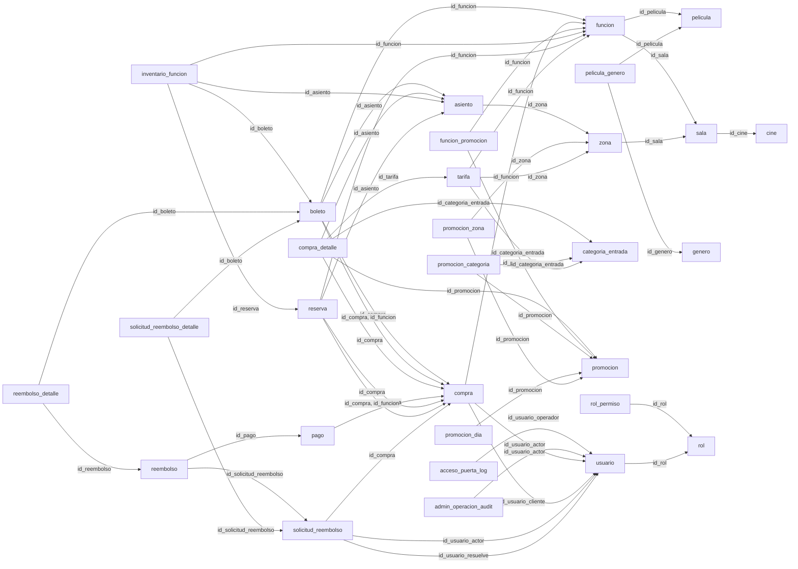

# Modelo relacional de la instalacion integrada

Este documento se obtuvo del esquema instalado por docs/integracion/instalacion_completa.sql. Contiene 33 tablas. Es el modelo relacional; el Chen global de la entrega se concilia a partir de este contrato.

## Relaciones entre tablas

Las flechas van desde la tabla que contiene la FK hacia la tabla referenciada. Los triggers complementan las FK para comprobar la sala de cada asiento, la correspondencia del precio y la proteccion por actividad.

## Tablas, tipos y restricciones

### acceso_puerta_log

| Columna | Tipo | Nulo |
| --- | --- | --- |
| id_acceso_puerta_log | integer | No |
| fecha | timestamp with time zone | No |
| id_boleto | bigint | Si |
| id_funcion_solicitada | integer | Si |
| id_usuario_operador | integer | No |
| dispositivo | character varying(100) | No |
| resultado | character varying(20) | No |
| motivo | character varying(200) | Si |

- CHECK (((resultado)::text = ANY ((ARRAY['aceptado'::character varying, 'rechazado'::character varying])::text[]))).
- FOREIGN KEY (id_usuario_operador) REFERENCES usuario(id_usuario).
- NOT NULL dispositivo.
- NOT NULL fecha.
- NOT NULL id_acceso_puerta_log.
- NOT NULL id_usuario_operador.
- NOT NULL resultado.

- PRIMARY KEY (id_acceso_puerta_log).

### admin_operacion_audit

| Columna | Tipo | Nulo |
| --- | --- | --- |
| id_admin_operacion_audit | integer | No |
| fecha | timestamp with time zone | No |
| id_usuario_actor | integer | No |
| rol_al_actuar | character varying(30) | No |
| ip | character varying(45) | No |
| accion | character varying(60) | No |
| entidad | character varying(60) | No |
| id_entidad | character varying(60) | Si |
| motivo | text | No |
| cambios | jsonb | Si |

- CHECK ((btrim(motivo) <> ''::text)).
- FOREIGN KEY (id_usuario_actor) REFERENCES usuario(id_usuario).
- NOT NULL accion.
- NOT NULL entidad.
- NOT NULL fecha.
- NOT NULL id_admin_operacion_audit.
- NOT NULL id_usuario_actor.
- NOT NULL ip.
- NOT NULL motivo.
- NOT NULL rol_al_actuar.

- PRIMARY KEY (id_admin_operacion_audit).

### asiento

| Columna | Tipo | Nulo |
| --- | --- | --- |
| id_asiento | integer | No |
| id_zona | integer | No |
| fila | character varying(10) | No |
| numero | integer | No |

- CHECK ((numero > 0)).
- FOREIGN KEY (id_zona) REFERENCES zona(id_zona).
- NOT NULL fila.
- NOT NULL id_asiento.
- NOT NULL id_zona.
- NOT NULL numero.

- PRIMARY KEY (id_asiento).
- UNIQUE (id_zona, fila, numero).

### asiento_auditoria_log

| Columna | Tipo | Nulo |
| --- | --- | --- |
| id_asiento_auditoria_log | bigint | No |
| creado_en | timestamp with time zone | No |
| id_funcion | bigint | No |
| id_asiento | bigint | No |
| id_compra | bigint | Si |
| id_usuario_actor | bigint | Si |
| evento | character varying(40) | No |
| estado_anterior | character varying(15) | Si |
| estado_nuevo | character varying(15) | Si |
| detalle | text | Si |
- NOT NULL creado_en.
- NOT NULL evento.
- NOT NULL id_asiento_auditoria_log.
- NOT NULL id_asiento.
- NOT NULL id_funcion.

- PRIMARY KEY (id_asiento_auditoria_log).

### boleto

| Columna | Tipo | Nulo |
| --- | --- | --- |
| id_boleto | bigint | No |
| id_compra | bigint | No |
| id_funcion | bigint | No |
| id_asiento | bigint | No |
| token_qr | uuid | No |
| estado | character varying(10) | No |
| emitido_en | timestamp with time zone | No |
| usado_en | timestamp with time zone | Si |

- CHECK ((((estado)::text = 'Usado'::text) = (usado_en IS NOT NULL))).

- CHECK (((estado)::text = ANY ((ARRAY['Emitido'::character varying, 'Usado'::character varying, 'Anulado'::character varying])::text[]))).
- FOREIGN KEY (id_asiento) REFERENCES asiento(id_asiento).
- FOREIGN KEY (id_compra) REFERENCES compra(id_compra).
- FOREIGN KEY (id_compra, id_funcion) REFERENCES compra(id_compra, id_funcion).
- FOREIGN KEY (id_funcion) REFERENCES funcion(id_funcion).
- NOT NULL emitido_en.
- NOT NULL estado.
- NOT NULL id_asiento.
- NOT NULL id_boleto.
- NOT NULL id_compra.
- NOT NULL id_funcion.
- NOT NULL token_qr.

- PRIMARY KEY (id_boleto).
- UNIQUE (token_qr).

### categoria_entrada

| Columna | Tipo | Nulo |
| --- | --- | --- |
| id_categoria_entrada | integer | No |
| nombre | character varying(50) | No |
| requiere_acreditacion | boolean | No |
- NOT NULL id_categoria_entrada.
- NOT NULL nombre.
- NOT NULL requiere_acreditacion.

- PRIMARY KEY (id_categoria_entrada).
- UNIQUE (nombre).

### cine

| Columna | Tipo | Nulo |
| --- | --- | --- |
| id_cine | integer | No |
| nombre | character varying(100) | No |
| ubicacion | text | No |
| zona_horaria | character varying(100) | No |
- NOT NULL id_cine.
- NOT NULL nombre.
- NOT NULL ubicacion.
- NOT NULL zona_horaria.

- PRIMARY KEY (id_cine).

### compra

| Columna | Tipo | Nulo |
| --- | --- | --- |
| id_compra | bigint | No |
| id_usuario_cliente | bigint | No |
| id_usuario_actor | bigint | No |
| id_funcion | bigint | No |
| estado | character varying(30) | No |
| total | numeric(10,2) | No |
| moneda | character(3) | No |
| creada_en | timestamp with time zone | No |

- CHECK (((estado)::text = ANY ((ARRAY['Pendiente'::character varying, 'Pagada'::character varying, 'Cancelada'::character varying, 'Expirada'::character varying, 'Reembolsada'::character varying, 'ParcialmenteReembolsada'::character varying])::text[]))).

- CHECK ((total >= (0)::numeric)).
- FOREIGN KEY (id_funcion) REFERENCES funcion(id_funcion).
- FOREIGN KEY (id_usuario_actor) REFERENCES usuario(id_usuario).
- FOREIGN KEY (id_usuario_cliente) REFERENCES usuario(id_usuario).
- NOT NULL creada_en.
- NOT NULL estado.
- NOT NULL id_compra.
- NOT NULL id_funcion.
- NOT NULL id_usuario_actor.
- NOT NULL id_usuario_cliente.
- NOT NULL moneda.
- NOT NULL total.

- PRIMARY KEY (id_compra).
- UNIQUE (id_compra, id_funcion).

### compra_detalle

| Columna | Tipo | Nulo |
| --- | --- | --- |
| id_compra_detalle | bigint | No |
| id_compra | bigint | No |
| id_asiento | integer | No |
| id_categoria_entrada | integer | No |
| id_tarifa | integer | No |
| id_promocion | bigint | Si |
| precio_base | numeric(10,2) | No |
| descuento | numeric(10,2) | No |
| cargo_servicio | numeric(10,2) | No |
| total_linea | numeric(10,2) | No |

- CHECK ((total_linea = ((precio_base - descuento) + cargo_servicio))).

- CHECK ((descuento >= (0)::numeric)).

- CHECK ((precio_base >= (0)::numeric)).
- FOREIGN KEY (id_asiento) REFERENCES asiento(id_asiento).
- FOREIGN KEY (id_categoria_entrada) REFERENCES categoria_entrada(id_categoria_entrada).
- FOREIGN KEY (id_compra) REFERENCES compra(id_compra).
- FOREIGN KEY (id_promocion) REFERENCES promocion(id_promocion).
- FOREIGN KEY (id_tarifa) REFERENCES tarifa(id_tarifa).
- NOT NULL cargo_servicio.
- NOT NULL descuento.
- NOT NULL id_asiento.
- NOT NULL id_categoria_entrada.
- NOT NULL id_compra_detalle.
- NOT NULL id_compra.
- NOT NULL id_tarifa.
- NOT NULL precio_base.
- NOT NULL total_linea.

- PRIMARY KEY (id_compra_detalle).
- UNIQUE (id_compra, id_asiento).

### funcion

| Columna | Tipo | Nulo |
| --- | --- | --- |
| id_funcion | integer | No |
| id_pelicula | integer | No |
| id_sala | integer | No |
| inicio | timestamp with time zone | No |
| fin | timestamp with time zone | No |
| activa | boolean | No |

- CHECK ((fin > inicio)).
- FOREIGN KEY (id_pelicula) REFERENCES pelicula(id_pelicula).
- FOREIGN KEY (id_sala) REFERENCES sala(id_sala).
- NOT NULL activa.
- NOT NULL fin.
- NOT NULL id_funcion.
- NOT NULL id_pelicula.
- NOT NULL id_sala.
- NOT NULL inicio.

- PRIMARY KEY (id_funcion).

### funcion_promocion

| Columna | Tipo | Nulo |
| --- | --- | --- |
| id_funcion | integer | No |
| id_promocion | integer | No |
- FOREIGN KEY (id_funcion) REFERENCES funcion(id_funcion).
- FOREIGN KEY (id_promocion) REFERENCES promocion(id_promocion).
- NOT NULL id_funcion.
- NOT NULL id_promocion.

- PRIMARY KEY (id_funcion, id_promocion).

### genero

| Columna | Tipo | Nulo |
| --- | --- | --- |
| id_genero | integer | No |
| nombre | character varying(50) | No |
- NOT NULL id_genero.
- NOT NULL nombre.

- PRIMARY KEY (id_genero).
- UNIQUE (nombre).

### inventario_funcion

| Columna | Tipo | Nulo |
| --- | --- | --- |
| id_funcion | integer | No |
| id_asiento | integer | No |
| estado | character varying(20) | No |
| id_reserva | bigint | Si |
| id_boleto | bigint | Si |

- CHECK (((((estado)::text = 'disponible'::text) AND (id_reserva IS NULL) AND (id_boleto IS NULL)) OR (((estado)::text = 'bloqueado'::text) AND (id_reserva IS NOT NULL) AND (id_boleto IS NULL)) OR (((estado)::text = 'vendido'::text) AND (id_reserva IS NOT NULL) AND (id_boleto IS NOT NULL)))).

- CHECK (((estado)::text = ANY ((ARRAY['disponible'::character varying, 'bloqueado'::character varying, 'vendido'::character varying])::text[]))).
- FOREIGN KEY (id_asiento) REFERENCES asiento(id_asiento).
- FOREIGN KEY (id_boleto) REFERENCES boleto(id_boleto).
- FOREIGN KEY (id_funcion) REFERENCES funcion(id_funcion).
- FOREIGN KEY (id_reserva) REFERENCES reserva(id_reserva).
- NOT NULL estado.
- NOT NULL id_asiento.
- NOT NULL id_funcion.

- PRIMARY KEY (id_funcion, id_asiento).
- UNIQUE (id_boleto).

### pago

| Columna | Tipo | Nulo |
| --- | --- | --- |
| id_pago | bigint | No |
| id_compra | bigint | No |
| estado | character varying(12) | No |
| metodo | character varying(20) | No |
| referencia | character varying(60) | No |
| monto | numeric(10,2) | No |
| moneda | character(3) | No |
| creado_en | timestamp with time zone | No |

- CHECK (((estado)::text = ANY ((ARRAY['Pendiente'::character varying, 'Aprobado'::character varying, 'Rechazado'::character varying, 'Reembolsado'::character varying])::text[]))).

- CHECK ((monto >= (0)::numeric)).
- FOREIGN KEY (id_compra) REFERENCES compra(id_compra).
- NOT NULL creado_en.
- NOT NULL estado.
- NOT NULL id_compra.
- NOT NULL id_pago.
- NOT NULL metodo.
- NOT NULL moneda.
- NOT NULL monto.
- NOT NULL referencia.

- PRIMARY KEY (id_pago).
- UNIQUE (referencia).

### pelicula

| Columna | Tipo | Nulo |
| --- | --- | --- |
| id_pelicula | integer | No |
| titulo | character varying(200) | No |
| sinopsis | text | No |
| clasificacion | character varying(30) | No |
| duracion_min | integer | No |
| poster_url | text | No |

- CHECK ((duracion_min > 0)).
- NOT NULL clasificacion.
- NOT NULL duracion_min.
- NOT NULL id_pelicula.
- NOT NULL poster_url.
- NOT NULL sinopsis.
- NOT NULL titulo.

- PRIMARY KEY (id_pelicula).

### pelicula_genero

| Columna | Tipo | Nulo |
| --- | --- | --- |
| id_pelicula | integer | No |
| id_genero | integer | No |
- FOREIGN KEY (id_genero) REFERENCES genero(id_genero).
- FOREIGN KEY (id_pelicula) REFERENCES pelicula(id_pelicula).
- NOT NULL id_genero.
- NOT NULL id_pelicula.

- PRIMARY KEY (id_pelicula, id_genero).

### politica_negocio

| Columna | Tipo | Nulo |
| --- | --- | --- |
| clave | character varying(60) | No |
| valor_entero | integer | No |
| descripcion | text | No |
| actualizada_en | timestamp with time zone | No |

- CHECK ((valor_entero >= 0)).
- NOT NULL actualizada_en.
- NOT NULL clave.
- NOT NULL descripcion.
- NOT NULL valor_entero.

- PRIMARY KEY (clave).

### promocion

| Columna | Tipo | Nulo |
| --- | --- | --- |
| id_promocion | integer | No |
| nombre | character varying(100) | No |
| tipo | character varying(30) | No |
| condicion | text | No |
| vigente_desde | timestamp with time zone | No |
| vigente_hasta | timestamp with time zone | No |
| activa | boolean | No |

- CHECK ((vigente_hasta > vigente_desde)).
- NOT NULL activa.
- NOT NULL condicion.
- NOT NULL id_promocion.
- NOT NULL nombre.
- NOT NULL tipo.
- NOT NULL vigente_desde.
- NOT NULL vigente_hasta.

- PRIMARY KEY (id_promocion).

### promocion_categoria

| Columna | Tipo | Nulo |
| --- | --- | --- |
| id_promocion | integer | No |
| id_categoria_entrada | integer | No |
- FOREIGN KEY (id_categoria_entrada) REFERENCES categoria_entrada(id_categoria_entrada).
- FOREIGN KEY (id_promocion) REFERENCES promocion(id_promocion).
- NOT NULL id_categoria_entrada.
- NOT NULL id_promocion.

- PRIMARY KEY (id_promocion, id_categoria_entrada).

### promocion_dia

| Columna | Tipo | Nulo |
| --- | --- | --- |
| id_promocion | integer | No |
| dia_semana | integer | No |

- CHECK (((dia_semana >= 1) AND (dia_semana <= 7))).
- FOREIGN KEY (id_promocion) REFERENCES promocion(id_promocion).
- NOT NULL dia_semana.
- NOT NULL id_promocion.

- PRIMARY KEY (id_promocion, dia_semana).

### promocion_zona

| Columna | Tipo | Nulo |
| --- | --- | --- |
| id_promocion | integer | No |
| id_zona | integer | No |
- FOREIGN KEY (id_promocion) REFERENCES promocion(id_promocion).
- FOREIGN KEY (id_zona) REFERENCES zona(id_zona).
- NOT NULL id_promocion.
- NOT NULL id_zona.

- PRIMARY KEY (id_promocion, id_zona).

### reembolso

| Columna | Tipo | Nulo |
| --- | --- | --- |
| id_reembolso | bigint | No |
| id_solicitud_reembolso | bigint | No |
| id_pago | bigint | No |
| referencia | character varying(80) | No |
| monto | numeric(12,2) | No |
| moneda | character varying(3) | No |
| creado_en | timestamp with time zone | No |

- CHECK ((monto > (0)::numeric)).
- FOREIGN KEY (id_pago) REFERENCES pago(id_pago).
- FOREIGN KEY (id_solicitud_reembolso) REFERENCES solicitud_reembolso(id_solicitud_reembolso).
- NOT NULL creado_en.
- NOT NULL id_pago.
- NOT NULL id_reembolso.
- NOT NULL id_solicitud_reembolso.
- NOT NULL moneda.
- NOT NULL monto.
- NOT NULL referencia.

- PRIMARY KEY (id_reembolso).
- UNIQUE (id_solicitud_reembolso).
- UNIQUE (referencia).

### reembolso_detalle

| Columna | Tipo | Nulo |
| --- | --- | --- |
| id_reembolso | bigint | No |
| id_boleto | bigint | No |
| monto | numeric(12,2) | No |

- CHECK ((monto > (0)::numeric)).
- FOREIGN KEY (id_boleto) REFERENCES boleto(id_boleto).
- FOREIGN KEY (id_reembolso) REFERENCES reembolso(id_reembolso).
- NOT NULL id_boleto.
- NOT NULL id_reembolso.
- NOT NULL monto.

- PRIMARY KEY (id_reembolso, id_boleto).
- UNIQUE (id_boleto).

### reserva

| Columna | Tipo | Nulo |
| --- | --- | --- |
| id_reserva | bigint | No |
| id_compra | bigint | No |
| id_funcion | bigint | No |
| id_asiento | bigint | No |
| estado | character varying(12) | No |
| categoria | character varying(20) | No |
| precio_unitario | numeric(10,2) | Si |
| creada_en | timestamp with time zone | No |
| vence_en | timestamp with time zone | No |

- CHECK (((estado)::text = ANY ((ARRAY['activa'::character varying, 'confirmada'::character varying, 'expirada'::character varying, 'liberada'::character varying])::text[]))).

- CHECK ((precio_unitario >= (0)::numeric)).
- FOREIGN KEY (id_asiento) REFERENCES asiento(id_asiento).
- FOREIGN KEY (id_compra) REFERENCES compra(id_compra).
- FOREIGN KEY (id_compra, id_funcion) REFERENCES compra(id_compra, id_funcion).
- FOREIGN KEY (id_funcion) REFERENCES funcion(id_funcion).
- NOT NULL categoria.
- NOT NULL creada_en.
- NOT NULL estado.
- NOT NULL id_asiento.
- NOT NULL id_compra.
- NOT NULL id_funcion.
- NOT NULL id_reserva.
- NOT NULL vence_en.

- PRIMARY KEY (id_reserva).

### rol

| Columna | Tipo | Nulo |
| --- | --- | --- |
| id_rol | integer | No |
| nombre | character varying(30) | No |
- NOT NULL id_rol.
- NOT NULL nombre.

- PRIMARY KEY (id_rol).
- UNIQUE (nombre).

### rol_permiso

| Columna | Tipo | Nulo |
| --- | --- | --- |
| id_rol | integer | No |
| accion | character varying(60) | No |
- FOREIGN KEY (id_rol) REFERENCES rol(id_rol).
- NOT NULL accion.
- NOT NULL id_rol.

- PRIMARY KEY (id_rol, accion).

### sala

| Columna | Tipo | Nulo |
| --- | --- | --- |
| id_sala | integer | No |
| id_cine | integer | No |
| nombre | character varying(100) | No |
- FOREIGN KEY (id_cine) REFERENCES cine(id_cine).
- NOT NULL id_cine.
- NOT NULL id_sala.
- NOT NULL nombre.

- PRIMARY KEY (id_sala).
- UNIQUE (id_cine, nombre).

### solicitud_reembolso

| Columna | Tipo | Nulo |
| --- | --- | --- |
| id_solicitud_reembolso | integer | No |
| id_compra | bigint | No |
| id_usuario_actor | integer | No |
| motivo | text | No |
| estado | character varying(20) | No |
| creada_en | timestamp with time zone | No |
| resuelta_en | timestamp with time zone | Si |
| id_usuario_resuelve | integer | Si |

- CHECK (((estado)::text = ANY ((ARRAY['pendiente'::character varying, 'ejecutada'::character varying, 'rechazada'::character varying])::text[]))).

- CHECK ((btrim(motivo) <> ''::text)).

- CHECK (((((estado)::text = 'pendiente'::text) AND (resuelta_en IS NULL) AND (id_usuario_resuelve IS NULL)) OR (((estado)::text <> 'pendiente'::text) AND (resuelta_en IS NOT NULL) AND (id_usuario_resuelve IS NOT NULL)))).
- FOREIGN KEY (id_usuario_actor) REFERENCES usuario(id_usuario).
- FOREIGN KEY (id_compra) REFERENCES compra(id_compra).
- FOREIGN KEY (id_usuario_resuelve) REFERENCES usuario(id_usuario).
- NOT NULL creada_en.
- NOT NULL estado.
- NOT NULL id_compra.
- NOT NULL id_solicitud_reembolso.
- NOT NULL id_usuario_actor.
- NOT NULL motivo.

- PRIMARY KEY (id_solicitud_reembolso).

### solicitud_reembolso_detalle

| Columna | Tipo | Nulo |
| --- | --- | --- |
| id_solicitud_reembolso | integer | No |
| id_boleto | bigint | No |
- FOREIGN KEY (id_boleto) REFERENCES boleto(id_boleto).
- FOREIGN KEY (id_solicitud_reembolso) REFERENCES solicitud_reembolso(id_solicitud_reembolso).
- NOT NULL id_boleto.
- NOT NULL id_solicitud_reembolso.

- PRIMARY KEY (id_solicitud_reembolso, id_boleto).

### tarifa

| Columna | Tipo | Nulo |
| --- | --- | --- |
| id_tarifa | integer | No |
| id_funcion | integer | No |
| id_zona | integer | No |
| id_categoria_entrada | integer | No |
| monto | numeric(12,2) | No |
| moneda | character varying(3) | No |
| vigente_desde | timestamp with time zone | No |
| vigente_hasta | timestamp with time zone | No |

- CHECK (((moneda)::text = 'USD'::text)).

- CHECK ((monto >= (0)::numeric)).

- CHECK ((vigente_hasta > vigente_desde)).
- FOREIGN KEY (id_categoria_entrada) REFERENCES categoria_entrada(id_categoria_entrada).
- FOREIGN KEY (id_funcion) REFERENCES funcion(id_funcion).
- FOREIGN KEY (id_zona) REFERENCES zona(id_zona).
- NOT NULL id_categoria_entrada.
- NOT NULL id_funcion.
- NOT NULL id_tarifa.
- NOT NULL id_zona.
- NOT NULL moneda.
- NOT NULL monto.
- NOT NULL vigente_desde.
- NOT NULL vigente_hasta.

- PRIMARY KEY (id_tarifa).

### transaccion_log

| Columna | Tipo | Nulo |
| --- | --- | --- |
| id_trasaccion_log | bigint | No |
| creado_en | timestamp with time zone | No |
| id_compra | bigint | Si |
| id_pago | bigint | Si |
| id_usuario_actor | bigint | Si |
| resultado | character varying(10) | No |
| evento | character varying(40) | No |
| estado_anterior | character varying(15) | Si |
| estado_nuevo | character varying(15) | Si |
| monto | numeric(10,2) | Si |
| moneda | character(3) | Si |
| detalle | text | Si |

- CHECK (((resultado)::text = ANY ((ARRAY['Exito'::character varying, 'Rechazado'::character varying, 'Fallido'::character varying])::text[]))).
- NOT NULL creado_en.
- NOT NULL evento.
- NOT NULL id_trasaccion_log.
- NOT NULL resultado.

- PRIMARY KEY (id_trasaccion_log).

### usuario

| Columna | Tipo | Nulo |
| --- | --- | --- |
| id_usuario | integer | No |
| id_rol | integer | No |
| nombre | character varying(100) | No |
| correo | character varying(150) | No |
| password_hash | text | No |
| activo | boolean | No |
| creado_en | timestamp with time zone | No |

- CHECK ((((correo)::text = lower(btrim((correo)::text))) AND ((correo)::text <> ''::text))).

- CHECK ((btrim((nombre)::text) <> ''::text)).
- FOREIGN KEY (id_rol) REFERENCES rol(id_rol).
- NOT NULL activo.
- NOT NULL correo.
- NOT NULL creado_en.
- NOT NULL id_rol.
- NOT NULL id_usuario.
- NOT NULL nombre.
- NOT NULL password_hash.

- PRIMARY KEY (id_usuario).
- UNIQUE (correo).

### zona

| Columna | Tipo | Nulo |
| --- | --- | --- |
| id_zona | integer | No |
| id_sala | integer | No |
| nombre | character varying(50) | No |
- FOREIGN KEY (id_sala) REFERENCES sala(id_sala).
- NOT NULL id_sala.
- NOT NULL id_zona.
- NOT NULL nombre.

- PRIMARY KEY (id_zona).
- UNIQUE (id_sala, nombre).

## Claves, dependencias e historia

Cada entidad conserva su identificador y las asociaciones usan sus FK. compra_detalle identifica una linea por compra y asiento; inventario_funcion identifica un estado actual por funcion y asiento. Las reservas y boletos conservan los intentos y ventas historicos.
El total de compra y el precio/descuento de cada linea se guardan deliberadamente como instantanea de cotizacion. No se recalculan con tarifas futuras. B conserva funcion y asiento en boleto; la FK compuesta con compra y las validaciones de detalle/distribucion evitan referencias incompatibles. Son decisiones explicitas de implementacion, no una afirmacion de que todos los valores almacenados sean independientes o de normalizacion pura.
